# Gate report: Phase 1 (database schema and data layer)

- Date: 2026-11-04
- Result: **PASS** (`scripts/ci.sh` exit 0)
- Decisions: [ADR 0002](../adr/0002-data-layer.md)

## What was built

### Shared core (`backend/app/core`)
| File | Purpose |
| --- | --- |
| `ids.py` | UUIDv7 generator (time-ordered, monotonic within a millisecond) |
| `context.py` | `current_actor_id` context variable and `acting_as()` (set by auth in Phase 3) |
| `models.py` | `Base` with constraint naming convention; `BusinessMixin`: `id` (UUIDv7), `created_at`, `updated_at`, `created_by`, `updated_by`, `is_deleted`, `row_version` (optimistic lock via `version_id_col`); `fk()` (always indexed), `enum_check()`, `status_column()` (always indexed) |
| `audit.py` | `audit_log` table and session hooks: insert / update / soft_delete / restore / delete rows with actor, request id, before and after JSON and changed fields, written in the same transaction |
| `files.py` | `files` table (sha256, original_name, mime, size, path, uploaded_by, ref_type/ref_id, exif_json, captured_at) and content-addressed store `DATA_DIR/objects/ab/cd/<sha256>` with atomic writes and `verify_object()` |
| `numbering.py` | `document_number_config` (prefix, padding, yearly reset; defaults PRJ, PR, PO, GRN, RTN, WO, LOT, QC, NCR, RPT, DOC) and gap-free `next_number()` using `SELECT ... FOR UPDATE` |
| `repository.py` | Generic `Repository[M]`: get, paginated list, whitelisted filters (`eq, ne, in, contains, gte, lte, isnull`) and sorting, create, optimistic-locked update, soft delete, restore |
| `jobs.py` | DB job queue: enqueue in caller's transaction, `FOR UPDATE SKIP LOCKED` claim, retries with backoff, lease-based reclaim, cancel. The worker now runs jobs every cycle |
| `errors.py` | Adds mappings: stale row_version → 409, unique → 409 `duplicate`, FK → 409 `reference_error`, CHECK → 422 `constraint_violation`, NOT NULL → 422, each with the constraint name |

### Domain model (42 tables, migration `0002`)
- **org**: divisions, projects, modules, pcb_assemblies, build_lots, serial_units
- **parts**: parts, part_preferred_vendors
- **procurement**: vendors (GSTIN format CHECK), purchase_requisitions, pr_lines, purchase_orders, po_lines, po_line_allocations (one PO line serving several BOQ lines/projects), goods_receipts, grn_lines (accepted + rejected + on hold = received), vendor_returns
- **inventory**: inventory_locations, inventory_ledger (append-only trigger, sign-by-reason CHECK), stock_balances (CHECK ≥ 0), stock_reservations; `service.py` with `post_movement`, `transfer`, `stock_on_hand` (from the ledger) and `verify_balances`
- **boq**: boqs, boq_revisions (one released per BOQ), boq_lines (stable `line_key`, attrition 0–100 %)
- **production**: stage_templates, stage_template_steps (default list from CLAUDE.md), work_orders, work_order_stages, stage_progress
- **qc**: qc_templates (versioned by code + version), qc_template_items (limits ordered, photo rules), qc_inspections (must have a lot, serial or GRN line), qc_results, ncrs (cannot close without disposition)
- **reports**: qc_reports (issued requires PDF hash), document_drafts, design_evaluations
- **core**: audit_log, files, jobs, document_number_config, document_sequences

Every foreign key and every `status` column is indexed (enforced by `tests/core/test_schema.py`
against the migrated database).

### Seed (`make seed`, idempotent)
Reference data: 7 inventory locations (stores, 2 bins, MSL dry cabinet, WIP, quarantine,
scrap) and the default "Standard PCBA" stage template (12 stages). Sample data, flagged
`is_sample = true` and labelled "(Sample)": 2 divisions, 3 projects (numbered `PRJ-2026-000n`
by the numbering service), 4 modules, 5 PCB assemblies, 60 real-world parts, 5 vendors with
invented Indian company names and valid-format GSTINs. Verified on a fresh database:
`seeded reference data: 20 rows`, `seeded sample data: 139 rows`; second run writes 0 rows.

## Required tests

| Requirement | Test | Status |
| --- | --- | --- |
| Migrations upgrade and downgrade cleanly on an empty database | `tests/core/test_migrations.py::test_upgrade_downgrade_upgrade` (+ `test_models_match_migrations`: `alembic check` finds no drift) | pass |
| Every constraint rejects bad data (one test per group) | `tests/core/test_constraints.py` (24 tests: unique, quantity, GRN split, stock ≥ 0, ledger sign, enum, dates, GSTIN format, FK, QC rules, NCR closure) | pass |
| Audit hook writes correct before/after on update and soft delete | `tests/core/test_audit.py` (6 tests incl. restore, hard delete, no-op update, rollback) | pass |
| Ledger: 50 random deltas, balance = SUM(ledger) every time | `tests/inventory/test_ledger.py::test_fifty_random_deltas_balance_equals_ledger_sum_every_time` | pass |
| Numbering: 200 concurrent requests → 200 unique, gap-free | `tests/core/test_numbering.py::test_200_concurrent_requests_unique_and_gap_free` (220 concurrent transactions, every 10th rolls back; the 198 committed numbers are exactly 1..198) | pass |
| Optimistic lock raises 409 on stale row_version | `tests/core/test_repository.py::test_stale_row_version_raises_conflict`, `test_api_returns_409_on_stale_row_version`, `test_concurrent_writers_second_gets_stale_data_conflict` | pass |

## CI summary (`scripts/ci.sh`)

```
==> Offline guard            ok
==> Lint        ruff: All checks passed! · 68 files already formatted · eslint: no warnings
==> Typecheck   mypy (strict): Success: no issues found in 67 source files · tsc: ok
==> Backend tests      126 passed
==> Frontend unit tests  Test Files 2 passed (2) · Tests 10 passed (10)
==> End-to-end tests   2 passed
CI passed
```

| Suite | Tests | Coverage |
| --- | --- | --- |
| Backend (pytest) | 126 | 96 % (`app/`, lines + branches) |
| Frontend unit (Vitest) | 10 | unchanged from Phase 0 |
| End-to-end (Playwright) | 2 | n/a |
| **Total** | **138** | |

Backend tests per file: audit 6, cli 4, config 3, constraints 24, errors 13, files 5,
harness 4, ids 2, jobs 8, logging 5, migrations 2, numbering 7, openapi 1, repository 9,
schema 4, seed 2, worker 7, health 10, inventory ledger 10.

## Known limits

- No business screens or endpoints yet (by design: Phase 1 builds the core). Divisions,
  projects, modules and assemblies get CRUD and UI in Phase 4; other modules in Phases 5–8.
- `created_by` / `updated_by` / `project_manager_id` / `inspector_id` are UUID columns
  without foreign keys until the users table arrives in Phase 3.
- EXIF extraction and thumbnails (Pillow) arrive with photo capture in Phase 8; the `files`
  table already has `exif_json` and `captured_at`.
- pgvector is not enabled in the local test PostgreSQL; compose already uses the pgvector
  image and Phase 9 adds the extension in a migration.

## ER diagram

Generated from the models by `scripts/er_diagram.py` (mixin columns `created_at`,
`updated_at`, `created_by`, `updated_by`, `is_deleted`, `row_version` omitted for
readability; every business table has them).

```mermaid
erDiagram
    audit_log {
        biginteger id PK
        timestamptz occurred_at
        uuid actor_id
        string action
        string entity_type
        string entity_id
        json before
        json after
        json changed_fields
        string request_id
    }
    boq_lines {
        uuid revision_id FK
        string line_key
        integer line_no
        uuid part_id FK
        text ref_des
        numeric qty_per_unit
        string mpn
        string manufacturer
        string description
        string value
        string package
        string category
        string unit
        boolean dnp
        numeric attrition_pct
        numeric unit_price
        uuid preferred_vendor_id FK
        text notes
        uuid id PK
    }
    boq_revisions {
        uuid boq_id FK
        string revision
        string status
        integer build_qty
        uuid source_file_id FK
        timestamptz released_at
        text notes
        uuid id PK
    }
    boqs {
        uuid project_id FK
        uuid module_id FK
        uuid assembly_id FK
        string name
        text notes
        uuid id PK
    }
    build_lots {
        uuid assembly_id FK
        uuid work_order_id FK
        string lot_number
        integer qty
        string status
        uuid id PK
    }
    design_evaluations {
        uuid assembly_id FK
        string title
        string status
        string kicad_version
        uuid source_file_id FK
        json summary
        text notes
        uuid signed_off_by
        timestamptz signed_off_at
        uuid id PK
    }
    divisions {
        string code
        string name
        text description
        boolean is_sample
        uuid id PK
    }
    document_drafts {
        string number
        integer revision
        string doc_type
        string title
        uuid project_id FK
        uuid module_id FK
        uuid assembly_id FK
        string status
        json content
        json source_data
        uuid approved_by
        timestamptz approved_at
        uuid id PK
    }
    document_number_config {
        string doc_type PK
        string description
        string prefix
        integer padding
        boolean yearly_reset
    }
    document_sequences {
        string doc_type PK
        integer year PK
        integer last_value
    }
    files {
        string sha256
        string original_name
        string mime
        biginteger size_bytes
        string storage_path
        uuid uploaded_by
        string ref_type
        uuid ref_id
        json exif_json
        timestamptz captured_at
        uuid id PK
    }
    goods_receipts {
        string number
        uuid purchase_order_id FK
        string status
        timestamptz received_at
        uuid received_by
        string delivery_note_ref
        text notes
        uuid id PK
    }
    grn_lines {
        uuid goods_receipt_id FK
        uuid po_line_id FK
        uuid location_id FK
        numeric qty_received
        numeric qty_accepted
        numeric qty_rejected
        numeric qty_on_hold
        string batch_lot
        string date_code
        integer msl_level
        string inspection_result
        text notes
        uuid id PK
    }
    inventory_ledger {
        biginteger id PK
        uuid part_id FK
        uuid location_id FK
        numeric qty_delta
        string reason
        string ref_type
        uuid ref_id
        string lot_code
        uuid project_id FK
        text note
        uuid user_id
    }
    inventory_locations {
        string code
        string name
        string kind
        uuid parent_id FK
        uuid id PK
    }
    jobs {
        uuid id PK
        string kind
        string status
        json payload
        json result
        text error
        integer progress
        integer attempts
        integer max_attempts
        timestamptz run_after
        timestamptz locked_at
        string locked_by
        timestamptz finished_at
    }
    modules {
        uuid project_id FK
        string code
        string name
        integer qty_to_deliver
        text description
        uuid id PK
    }
    ncrs {
        string number
        uuid project_id FK
        uuid inspection_id FK
        uuid qc_result_id FK
        uuid serial_unit_id FK
        uuid lot_id FK
        string defect_category
        string severity
        text description
        text root_cause
        string disposition
        text rework_notes
        string status
        uuid reinspection_id FK
        uuid closed_by
        timestamptz closed_at
        uuid id PK
    }
    part_preferred_vendors {
        uuid part_id FK
        uuid vendor_id FK
        integer rank
        string vendor_part_number
        uuid id PK
    }
    parts {
        string mpn
        string manufacturer
        string description
        string package
        string value
        string category
        string unit
        integer msl_level
        integer min_stock
        text notes
        boolean is_sample
        uuid id PK
    }
    pcb_assemblies {
        uuid module_id FK
        string code
        string board_name
        string revision
        integer qty_per_module
        integer layer_count
        numeric size_x_mm
        numeric size_y_mm
        string finish
        uuid kicad_project_file_id FK
        uuid assembly_drawing_file_id FK
        uuid stage_template_id FK
        text notes
        uuid id PK
    }
    po_line_allocations {
        uuid po_line_id FK
        uuid boq_line_id FK
        uuid project_id FK
        numeric qty
        uuid id PK
    }
    po_lines {
        uuid purchase_order_id FK
        integer line_no
        uuid part_id FK
        numeric qty_ordered
        numeric unit_price
        date expected_date
        boolean is_cancelled
        text notes
        uuid id PK
    }
    pr_lines {
        uuid requisition_id FK
        uuid boq_line_id FK
        uuid part_id FK
        numeric qty
        uuid suggested_vendor_id FK
        text notes
        uuid id PK
    }
    projects {
        uuid division_id FK
        string code
        string name
        string client_name
        string client_po_ref
        date start_date
        date due_date
        string status
        uuid project_manager_id
        text notes
        boolean is_sample
        uuid id PK
    }
    purchase_orders {
        string number
        uuid vendor_id FK
        uuid requisition_id FK
        string status
        date order_date
        string currency
        timestamptz issued_at
        text notes
        uuid id PK
    }
    purchase_requisitions {
        string number
        uuid project_id FK
        string status
        uuid approved_by
        timestamptz approved_at
        text notes
        uuid id PK
    }
    qc_inspections {
        string number
        uuid template_id FK
        uuid work_order_stage_id FK
        uuid lot_id FK
        uuid serial_unit_id FK
        uuid grn_line_id FK
        string stage_code
        string status
        uuid inspector_id
        timestamptz started_at
        timestamptz completed_at
        uuid reinspection_of_id FK
        uuid id PK
    }
    qc_reports {
        string number
        integer revision
        uuid project_id FK
        json scope
        string status
        boolean client_safe
        json narrative
        json source_data
        uuid pdf_file_id FK
        string pdf_sha256
        uuid reviewed_by
        timestamptz reviewed_at
        uuid approved_by
        timestamptz approved_at
        timestamptz issued_at
        uuid id PK
    }
    qc_results {
        uuid inspection_id FK
        uuid template_item_id FK
        string result
        numeric measured_value
        text text_value
        text notes
        uuid id PK
    }
    qc_template_items {
        uuid template_id FK
        integer seq
        string item_type
        text prompt
        boolean is_required
        numeric min_value
        numeric max_value
        string unit
        boolean photo_required
        integer min_photos
        uuid reference_file_id FK
        uuid id PK
    }
    qc_templates {
        string code
        integer version
        string name
        string stage_code
        uuid assembly_id FK
        integer ipc_class
        string status
        text description
        uuid id PK
    }
    serial_units {
        uuid assembly_id FK
        uuid lot_id FK
        string serial_number
        string status
        uuid id PK
    }
    stage_progress {
        uuid work_order_stage_id FK
        uuid lot_id FK
        uuid serial_unit_id FK
        string status
        timestamptz started_at
        timestamptz completed_at
        integer qty_passed
        integer qty_failed
        uuid operator_id
        text notes
        uuid id PK
    }
    stage_template_steps {
        uuid template_id FK
        integer seq
        string stage_code
        string name
        boolean requires_qc
        uuid id PK
    }
    stage_templates {
        string name
        text description
        boolean is_default
        uuid id PK
    }
    stock_balances {
        uuid part_id PK,FK
        uuid location_id PK,FK
        numeric qty_on_hand
    }
    stock_reservations {
        uuid part_id FK
        uuid project_id FK
        uuid location_id FK
        numeric qty
        string status
        text note
        uuid id PK
    }
    vendor_returns {
        string number
        uuid grn_line_id FK
        uuid vendor_id FK
        numeric qty
        text reason
        string status
        uuid id PK
    }
    vendors {
        string code
        string name
        string gstin
        text address
        string city
        string state
        json contacts
        string payment_terms
        integer lead_time_days
        numeric rating
        text notes
        boolean is_sample
        uuid id PK
    }
    work_order_stages {
        uuid work_order_id FK
        integer seq
        string stage_code
        string name
        boolean requires_qc
        string status
        uuid id PK
    }
    work_orders {
        string number
        uuid project_id FK
        uuid module_id FK
        uuid assembly_id FK
        integer build_qty
        string status
        date planned_start
        date planned_end
        timestamptz released_at
        text release_override_reason
        boolean track_serials
        text notes
        uuid id PK
    }
    parts |o--o{ boq_lines : "part_id"
    vendors |o--o{ boq_lines : "preferred_vendor_id"
    boq_revisions ||--o{ boq_lines : "revision_id"
    boqs ||--o{ boq_revisions : "boq_id"
    files |o--o{ boq_revisions : "source_file_id"
    pcb_assemblies |o--o{ boqs : "assembly_id"
    modules |o--o{ boqs : "module_id"
    projects ||--o{ boqs : "project_id"
    pcb_assemblies ||--o{ build_lots : "assembly_id"
    work_orders |o--o{ build_lots : "work_order_id"
    pcb_assemblies ||--o{ design_evaluations : "assembly_id"
    files |o--o{ design_evaluations : "source_file_id"
    pcb_assemblies |o--o{ document_drafts : "assembly_id"
    modules |o--o{ document_drafts : "module_id"
    projects |o--o{ document_drafts : "project_id"
    purchase_orders ||--o{ goods_receipts : "purchase_order_id"
    goods_receipts ||--o{ grn_lines : "goods_receipt_id"
    inventory_locations |o--o{ grn_lines : "location_id"
    po_lines ||--o{ grn_lines : "po_line_id"
    inventory_locations ||--o{ inventory_ledger : "location_id"
    parts ||--o{ inventory_ledger : "part_id"
    projects |o--o{ inventory_ledger : "project_id"
    inventory_locations |o--o{ inventory_locations : "parent_id"
    projects ||--o{ modules : "project_id"
    qc_inspections |o--o{ ncrs : "inspection_id"
    build_lots |o--o{ ncrs : "lot_id"
    projects ||--o{ ncrs : "project_id"
    qc_results |o--o{ ncrs : "qc_result_id"
    qc_inspections |o--o{ ncrs : "reinspection_id"
    serial_units |o--o{ ncrs : "serial_unit_id"
    parts ||--o{ part_preferred_vendors : "part_id"
    vendors ||--o{ part_preferred_vendors : "vendor_id"
    files |o--o{ pcb_assemblies : "assembly_drawing_file_id"
    files |o--o{ pcb_assemblies : "kicad_project_file_id"
    modules ||--o{ pcb_assemblies : "module_id"
    stage_templates |o--o{ pcb_assemblies : "stage_template_id"
    boq_lines ||--o{ po_line_allocations : "boq_line_id"
    po_lines ||--o{ po_line_allocations : "po_line_id"
    projects ||--o{ po_line_allocations : "project_id"
    parts ||--o{ po_lines : "part_id"
    purchase_orders ||--o{ po_lines : "purchase_order_id"
    boq_lines |o--o{ pr_lines : "boq_line_id"
    parts ||--o{ pr_lines : "part_id"
    purchase_requisitions ||--o{ pr_lines : "requisition_id"
    vendors |o--o{ pr_lines : "suggested_vendor_id"
    divisions ||--o{ projects : "division_id"
    purchase_requisitions |o--o{ purchase_orders : "requisition_id"
    vendors ||--o{ purchase_orders : "vendor_id"
    projects ||--o{ purchase_requisitions : "project_id"
    grn_lines |o--o{ qc_inspections : "grn_line_id"
    build_lots |o--o{ qc_inspections : "lot_id"
    qc_inspections |o--o{ qc_inspections : "reinspection_of_id"
    serial_units |o--o{ qc_inspections : "serial_unit_id"
    qc_templates ||--o{ qc_inspections : "template_id"
    work_order_stages |o--o{ qc_inspections : "work_order_stage_id"
    files |o--o{ qc_reports : "pdf_file_id"
    projects ||--o{ qc_reports : "project_id"
    qc_inspections ||--o{ qc_results : "inspection_id"
    qc_template_items ||--o{ qc_results : "template_item_id"
    files |o--o{ qc_template_items : "reference_file_id"
    qc_templates ||--o{ qc_template_items : "template_id"
    pcb_assemblies |o--o{ qc_templates : "assembly_id"
    pcb_assemblies ||--o{ serial_units : "assembly_id"
    build_lots |o--o{ serial_units : "lot_id"
    build_lots ||--o{ stage_progress : "lot_id"
    serial_units |o--o{ stage_progress : "serial_unit_id"
    work_order_stages ||--o{ stage_progress : "work_order_stage_id"
    stage_templates ||--o{ stage_template_steps : "template_id"
    inventory_locations ||--o{ stock_balances : "location_id"
    parts ||--o{ stock_balances : "part_id"
    inventory_locations |o--o{ stock_reservations : "location_id"
    parts ||--o{ stock_reservations : "part_id"
    projects ||--o{ stock_reservations : "project_id"
    grn_lines ||--o{ vendor_returns : "grn_line_id"
    vendors ||--o{ vendor_returns : "vendor_id"
    work_orders ||--o{ work_order_stages : "work_order_id"
    pcb_assemblies ||--o{ work_orders : "assembly_id"
    modules |o--o{ work_orders : "module_id"
    projects ||--o{ work_orders : "project_id"
```


