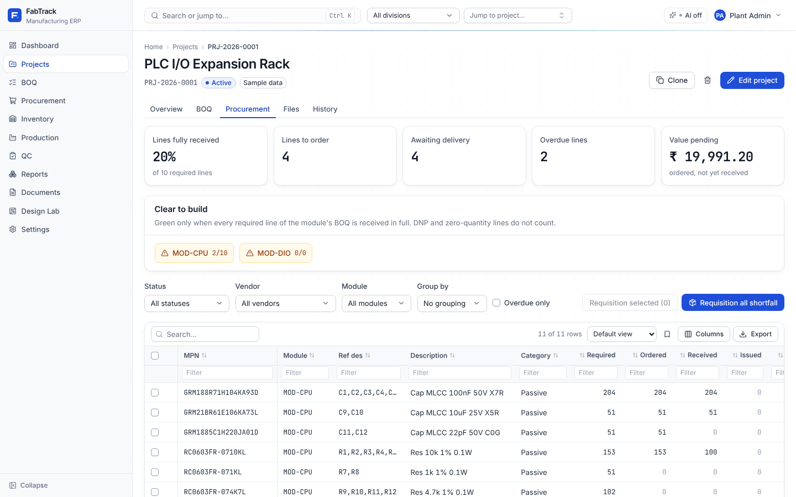

# Gate report: Phase 6 (procurement, receiving, inventory and pending tracking)

- Date: 2026-11-05
- Result: **PASS** (`scripts/ci.sh` exit 0, 218 s)



*The tracker on the sample PLC rack project (fresh install with `make seed`):*
- *KPIs and clear to build per module;*
- *every BOQ line with required, ordered, received, issued, to order, awaiting, expected
  date, days late, vendor, clickable PO numbers and the status pill.*

More screenshots: [pending deliveries](phase-06/pending.png),
[purchase order](phase-06/po.png), [receive goods](phase-06/receive.png),
[goods receipt](phase-06/grn.png), [inventory](phase-06/inventory.png).

## What was built

Design decisions are recorded in [ADR 0004](../adr/0004-procurement-quantities.md).

### Backend (`app/modules/procurement`, `app/modules/inventory`)

- **Vendors**: code, name, GSTIN (format-checked), address, contacts, payment terms, lead
  time, rating, notes and documents (attachments, ref type `vendor`). A vendor with orders
  cannot be deleted.
- **Purchase requisitions**:
  - raised from BOQ shortfall (selected lines, or every short line of the project's
    released revisions), for the quantity not already on a requisition or draft PO;
  - the part's preferred vendor is suggested;
  - draft → submitted → approved (PM) or rejected (with reason; editable and
    resubmittable) → converted into one draft PO per vendor, each line allocated to its
    BOQ line.
- **Purchase orders**:
  - from requisitions or created directly; lines allocated explicitly to BOQ lines (and
    their projects), with one line able to serve several projects;
  - expected date per line; issue (needs prices), cancel (only before receipts), close;
  - cancel a line's undelivered remainder, and update the promised date or note;
  - status follows receipts: issued → partially received → received.
  - **PO PDF**: Jinja2 template with the company letterhead (logo, address, GSTIN), the
    vendor block, terms and line table, rendered by WeasyPrint with bundled fonts and an
    offline-only URL fetcher.
- **Goods receipts**:
  - partial receipts with location, lot, date code and MSL (defaulted from the part);
  - incoming inspection split (accepted / rejected / on hold);
  - only accepted quantity posts to the ledger, spread over allocations and reserved
    per project;
  - rejected quantity creates a vendor return; holds are resolved later;
  - CoC link and packaging photos (attachments, ref type `grn`);
  - the PO row lock prevents concurrent over-receipt.
- **Vendor returns**: open → shipped → credited / replaced → closed.
- **Inventory**:
  - stock by part (on hand, usable, reserved, available, low-stock flag against the
    part's minimum) and by location;
  - ledger listing; transfers (reservations follow the stock);
  - adjustments that change stock only when approved by someone else;
  - project reservations (manual and automatic at GRN) with release;
  - part minimum stock / MSL edit (`PATCH /parts/{id}`).
  - `issue_to_boq_line` / `return_from_boq_line` are the service entry points for Phase 7
    kitting.
- **Status service inputs**:
  - ordered, received and issued per BOQ line (`procurement/quantities.py`), summed over
    the line key across revisions;
  - drafts are "being ordered", not ordered (ADR 0004).
- **Tracker** (`GET /projects/{id}/tracker`):
  - every line with quantities, status, vendors, PO links, expected date, days overdue
    and value pending;
  - KPIs (% of required lines fully received, lines to order, awaiting delivery, overdue
    lines, value pending);
  - clear to build per module, plus "Project-wide items" for BOQs without a module, with
    the reason when not clear;
  - BOQs whose current revision is not released are flagged.
- **Cross-project pending view** (`GET /procurement/pending`): every open PO line owed by
  a vendor, soonest expected first, with days late and the projects it serves.
- **Scoping**: requisitions follow their project; orders, receipts and returns are
  visible to a scoped user only when they serve one of the user's projects.
- **Setup and seed data**:
  - first-run setup now creates the reference data (stock locations, default stage
    template), so a fresh install can receive goods;
  - new seeder `seed_sample_procurement`: two orders against the sample BOQ, one partly
    received, so the tracker shows Received, Partially received, Ordered (one overdue)
    and Not ordered lines.
- Migration **0005**:
  - tables: `grn_allocations`, `stock_adjustments`;
  - columns: `goods_receipts.coc_file_id`, `purchase_requisitions.submitted_at` and
    `decision_note`.
- Dependencies: WeasyPrint 70 and Jinja2 added to `pyproject.toml` and the lock file.
  The Docker image installs Pango and HarfBuzz; Inter and JetBrains Mono are bundled in
  `app/templates/fonts`.

### Frontend (`src/features/procurement`, `src/features/inventory`)

- **Project → Procurement tab (tracker)**:
  - KPI cards and clear-to-build chips with reasons;
  - filters (status, vendor, module, overdue only) and grouping by vendor or category
    (one section per group);
  - row selection with **Requisition selected** and **Requisition all shortfall**;
  - CSV/XLSX export, PO links and an unreleased-BOQ warning.
- **Procurement page**: Pending deliveries (with promised-date follow-up), Requisitions,
  Purchase orders, Goods receipts, Vendor returns and Vendors (drawer with contacts and
  documents).
- **Requisition page**: vendor per line, quantities, submit, approve or reject (reason
  required), create purchase orders.
- **Purchase order page**:
  - lines with allocations ("serves PRJ…"), receipts list and KPIs;
  - actions: Edit (draft, full editor with part search and per-project allocations),
    Issue, PDF, Cancel, Close, line date change, cancel remainder;
  - **Receive goods** dialog: accepted is computed from received − rejected − on hold;
    MSL parts default to the dry cabinet; a rejection needs a reason.
- **Goods receipt page**: lines with inspection result and where the stock was reserved,
  hold decisions, CoC link, photos, returns.
- **Inventory page**: Stock (reserve, minimum stock), By location (move, request an
  adjustment), Ledger, Adjustments (approve or reject; your own request has no approve
  button) and Reservations (release).
- User guides: [procurement](../user-guide/procurement.md),
  [inventory](../user-guide/inventory.md).

## Required tests

| Requirement | Test | Status |
| --- | --- | --- |
| Status service: every transition, incl. over-receipt, cancellation, PO line serving two projects, rejection at GRN | `tests/boq/test_status.py` (every branch); `tests/procurement/test_rules.py::test_status_over_receipt_and_rejection_branches`; end to end in `tests/procurement/test_cycle.py`: `test_over_receipt_is_refused_and_extra_ordered_stock_is_free`, `test_cancellation` (whole order, then a line's remainder after a partial receipt), `test_po_line_serving_two_projects` (150 for 100 + 50; receipt of 120 → P1 Received, P2 Partially received 20/50, ledger split per project, pending view), `test_rejection_at_grn_creates_a_return_and_stays_outstanding`, `test_hold_then_resolve` | pass |
| Ledger consistency after a full PR → PO → GRN → issue cycle | `test_full_cycle_keeps_ledger_consistent`: shortfall PR, vendor choice, approval (purchase cannot approve), conversion, prices, issue, partial and final GRN (MSL defaulted, lot recorded, reservation created), kitting issue → Issued. `verify_balances()` is empty and stock on hand = received − issued. | pass |
| Clear-to-build logic on edge cases | `test_clear_to_build_edge_cases`: DNP line and zero-quantity line are "Not required" and never block; module with no BOQ; module whose BOQ is unreleased; 9/10 received is not clear; 10/10 is. Also `test_full_cycle…` (green at the end). | pass |
| Concurrency: two users receiving the same PO line cannot over-receive | `tests/procurement/test_concurrency.py`: 8 concurrent receipts of 4 against 10 outstanding on separate committed connections → exactly 2 posted, 6 refused `over_receipt`, 8 in stock, balances consistent. Verified to fail when the PO row lock is removed. | pass |
| Playwright: shortfall → PR → PO → partial GRN → tracker "Partially received" with correct numbers → final GRN → "Received" | `frontend/e2e/procurement.spec.ts`. Through the UI: requisition all shortfall, vendor per line, submit, approve, create PO, set prices, issue, receive 60 of 100 plus all 10 MCUs. The tracker then shows Partially received with 60 received and 40 awaiting, and the module not clear to build. A final receipt of 40 gives Received, 100 % and clear to build, and the stock appears on the inventory page. | pass |

Also:
- **API tests**:
  - `test_orders_against_revision_a_count_on_revision_b`;
  - `test_requisition_rules` (unreleased revision, nothing-to-order, rejection reason,
    reopen after rejection, vendor missing at conversion);
  - `test_po_validation` (part mismatch, over-allocation, issued orders not editable,
    promised date, close still counts as ordered);
  - `test_vendors`, `test_permissions_and_scope` (role checks and project scoping of
    orders, tracker and pending), `test_po_pdf`, `test_grn_coc_listings_and_returns`,
    `test_sample_purchasing_seed`;
  - `tests/inventory/test_inventory_api.py` (transfers, approval by someone else only,
    reservations against available stock, quarantine not usable, low-stock flag);
  - setup creates the stock locations.
- **Frontend unit tests**:
  - `tests/procurement.test.tsx` (9): tracker KPIs, filters, grouping, requisition from
    shortfall; requisition vendor and save, rejection reason; receive dialog maths, MSL
    default and payload; issue confirmation; pending list and date follow-up; vendor
    GSTIN validation; PO editor checks;
  - `tests/inventory.test.tsx` (3): low stock and self-approval hiding, transfer and
    counted adjustment, reservation, minimum stock, ledger and release.
- **e2e**: axe scan (WCAG 2 A/AA) of the tracker, a draft PO, the procurement lists and
  the ledger, with 0 violations.

## Defects found during the gate and fixed

| Defect | Root cause | Fix | Regression test |
| --- | --- | --- | --- |
| A fresh installation had no stock locations, so goods could not be received | Reference data was only created by `make seed` | First-run setup creates it (idempotent) | `test_first_run_setup_creates_admin_and_signs_in`; `procurement.spec.ts` on a fresh DB |
| Receiving failed with "choose where it goes" when quantities were typed before the location list loaded | The row captured an empty default location | Location falls back to the default until one is picked | `procurement.spec.ts`; `procurement.test.tsx` receive test |
| Cancelling a partly received order said only "partially received" | Status check ran before the receipt check | Receipt check first, with a clear message to cancel the remaining lines | `test_cancellation` |
| Old tests treated Procurement as unbuilt | Roadmap placeholders moved on | Placeholder tests now use Production (Phase 7) | `app.test.tsx`, `projects.test.tsx` |

## CI summary (`scripts/ci.sh`)

```
==> Offline guard            ok
==> Lint        ruff: All checks passed! · eslint: 0 problems
==> Typecheck   mypy (strict): Success: no issues found in 139 source files · tsc: ok
==> Backend tests      270 passed
==> Frontend unit tests  Test Files 11 passed (11) · Tests 122 passed (122)
==> End-to-end tests   33 passed
CI passed in 218s
```

| Suite | Tests | Coverage |
| --- | --- | --- |
| Backend (pytest) | 270 (20 new: procurement 17, inventory 3) | 94 % overall; procurement quantities 100 %, router 98 %, schemas 97 %, tracker 94 %, service 90 %, PDF 78 %; inventory service 85 % |
| Frontend unit (Vitest) | 122 (12 new) | 77.7 % lines overall; `features/inventory` 94 %, `features/procurement` 64 % (the PO editor's allocation rows and the receipt page are covered by e2e) |
| End-to-end (Playwright) | 33 | adds the Phase 6 journey and accessibility scan |
| **Total** | **425** | |

## Known limits

- No over-receipt tolerance: a vendor's extra quantity needs its own PO line first (ADR
  0004). A tolerance percentage could become a company setting.
- A posted GRN cannot be reversed. Correct mistakes with a stock adjustment (needs
  approval) and a vendor return.
- Taxes (GST) are not computed. The PO shows totals before tax with "Taxes as applicable";
  tax invoices are outside FabTrack's scope.
- One currency (INR) per installation; the PO has a currency column for later.
- Issued quantities stay 0 until Phase 7 kitting calls `issue_to_boq_line`, so "Issued"
  only appears in tests until then.
- Low-stock alerts are shown on the Inventory page. They join the dashboard and
  notifications in Phase 13.
- Grouping in the tracker renders one table per group; there are no subtotal rows.
