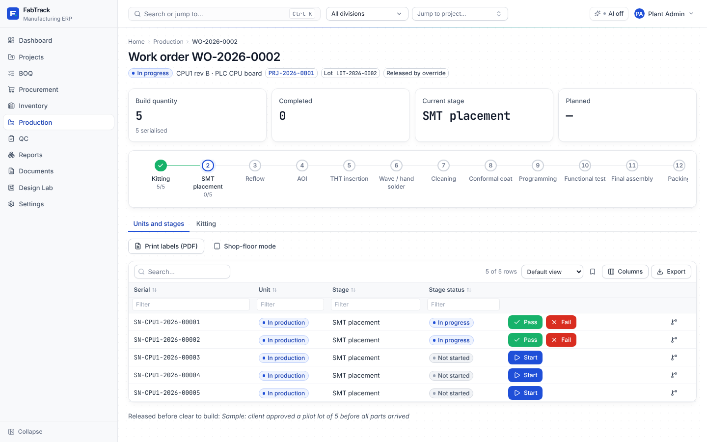

# Gate report: Phase 7 (production work orders and assembly stages)

- Date: 2026-11-06
- Result: **PASS** (`scripts/ci.sh` exit 0, 236 s, no flaky tests)



More screenshots: [board](phase-07/board.png), [kitting](phase-07/kitting.png),
[stage templates](phase-07/templates.png),
[shop floor on a tablet](phase-07/shop-floor-tablet.png). They come from a fresh install
with `make seed`: a planned order and a pilot lot of 5 released by override, kitted
from stores, with two boards in SMT.

Design decisions: [ADR 0005](../adr/0005-production.md).

## What was built

### Backend (`app/modules/production`)

- **Stage templates**:
  - list with steps and usage; create by copying (default: the default template);
  - edit: rename, reorder, custom stages, QC flag per stage;
  - delete only when unused, never the default.
- **Work orders**:
  - one assembly, one build lot (numbered `LOT-…`), stages copied from the assembly's
    template;
  - the BOQ to kit from is picked automatically (the board's BOQ, else the module's)
    or chosen;
  - edit while planned; cancel (refused while kitted parts are out); close once
    completed.
- **Release gate**:
  - needs the module clear to build (the tracker's rule);
  - otherwise only `wo:override_release` (PM, Admin) with a reason, stored on the order
    and written as a `release_override` audit event with the readiness at that moment.
- **Kitting**:
  - kit list per order: required for this build quantity, issued, short, reserved for
    the project, in stock;
  - issue in batches by location and lot (ledger ISSUE against the BOQ line, so
    "Issued" reaches the tracker); reservations are consumed;
  - lot-availability and over-issue checks;
  - return (ledger RETURN, re-reserved), limited to what was issued from that lot;
  - lot stock endpoint `GET /inventory/lots?part_id=` for picking.
- **Serials**:
  - `{prefix}-{ASSEMBLY}-{year}-{nnnnn}`, from a per-assembly, per-year counter taken
    under a row lock;
  - the prefix is a company setting (Settings → General);
  - lot-only orders refuse serials;
  - **labels PDF**: A4 3 × 8 labels with a QR (segno) of the serial, the board, the
    order and the lot.
- **Stage progress**:
  - per unit (serial tracking) or per lot (lot tracking, passed/failed quantities
    flow on);
  - start → finish (awaiting QC) → complete; a stage starts only after the previous
    one completed (and passed, for a unit);
  - **QC stages complete only with a passed inspection** of the stage, for the unit or
    its whole lot, checked in the service;
  - failed units stop; stage, work order and lot statuses are derived after every
    change.
- **Genealogy** (`/serial-units/{id}/genealogy`): the net part lots kitted to the unit's
  work order, by BOQ line.
- **Scan** (`/production/scan?code=`): case-insensitive serial lookup with the unit's
  current stage and next action.
- **Board** (`/production/board`): Planned, Released, one column per standard stage
  (custom stages grouped), Completed.
- **QC service**: `passed_inspection_exists` (inspections themselves arrive in Phase 8).
- **Shared PDF renderer** `app/core/pdf.py`, used by POs and labels: a WeasyPrint 70
  `URLFetcher` that allows only bundled template files and data URIs.
- **Seed data** `seed_sample_production`: a planned order (not clear to build) and a
  pilot lot of 5 released by override, serialised, kitted from stores (three lines,
  with lots) and partly through SMT.
- **First-run setup** already creates the default stage template (Phase 6).
- Migration **0006**:
  - tables: `kit_issues`, `serial_sequences`;
  - columns: `work_orders.boq_id`, `company_settings.serial_prefix`;
  - unique stage-progress indexes per lot and per serial.

### Frontend (`src/features/production`)

- **Production page**: Board (kanban with stage progress and awaiting-QC counts), Work
  orders (list) and Stage templates (cards plus an editor: reorder, add custom stages,
  QC toggle, copy, delete). Primary action **New work order**; **Shop-floor mode** link.
- **Work order page**:
  - status, board, project, lot and override badges; KPIs; the **Stepper** with
    per-stage progress;
  - **Release** dialog: clear-to-build check, override reason for PMs;
  - **Units and stages** (serials): generate serials, print labels, a per-unit
    Start / Pass / Fail at the current stage, "Waiting for QC inspection", genealogy;
  - lot-tracked orders get a stage list with passed/failed entry.
  - **Kitting**: kit list (DNP and zero lines hidden). Issue offers lots oldest first,
    pre-filled up to the shortage; lines with no stock say so. Return, plus the
    issues-and-returns log.
- **New / edit work order** drawer (project → board, build quantity defaulting to the
  module's, BOQ, dates, serial vs lot tracking).
- **Project → Production tab**: the project's work orders and New work order.
- **Shop-floor mode** (`/shop-floor`, full screen, tablet sized):
  - a large serial box that always has focus (handheld scanners work as keyboards);
  - **Camera** QR scan decoded locally with jsQR (needs HTTPS; says so otherwise);
  - the unit card with large Start / Pass / Fail;
  - the released work orders with tappable units, or lot controls.
- **Settings → General**: serial number prefix, with a live example.
- **Design system fix**: DataTable now calls cell and header renderers instead of
  mounting them (see defects).
- User guide: [production](../user-guide/production.md).

## Required tests

| Requirement | Test | Status |
| --- | --- | --- |
| Release blocking and override audit | `test_release_gate_and_override_audit`: not clear → 409 for Production; Production may not override (403); PM override stores the reason and writes the `release_override` audit event (actor, reason, readiness). `test_release_when_clear_needs_no_reason`: released without override; double release and editing a released order refused. | pass |
| Kitting ledger entries and returns | `test_kitting_ledger_entries_and_returns`: kitting before release refused; required quantities for this build; lot availability and over-issue refused; batch issue from two lots creates ISSUE ledger rows (ref boq_line, project, lot); reservations consumed (20 → 12); tracker Issued = 8. A return beyond that lot's issue is refused. A return of 2 creates a RETURN row and re-reserves; Issued = 6, stock = 14, balances consistent. Cancel refused with parts out; QC Lead cannot kit. | pass |
| Serial generation uniqueness and format under concurrency | `test_serial_generation_format_and_limits` (prefix from settings, format, continuation, lot limit, lot-only refusal, labels PDF); `test_serial_concurrency.py`: 8 orders of one assembly generate 5 serials each at once on separate connections, giving 40 unique, gap-free numbers 1–40 in consecutive blocks. Verified to fail without the row lock. | pass |
| Stage gating by QC (cannot bypass via API) | `test_stage_gating_by_qc_cannot_be_bypassed`: wrong stage order refused; completing a QC stage directly, after finish, or with only a failed inspection refused (`qc_required`); a passed unit inspection opens it for that unit only; a passed lot-level inspection covers every unit; failed units cannot continue; order completes with 1 passed / 1 failed; Viewer cannot record progress | pass |
| Genealogy query returns the correct part lots for a serial | `test_genealogy_returns_the_part_lots_of_a_serial`: lots issued to the order (minus a fully returned lot), not those of another order; also checked on the seeded pilot order | pass |
| Playwright: release WO → kit → progress through 3 stages on tablet viewport | `frontend/e2e/production.spec.ts`, at 1024 × 768 with touch. Arranged through the API: a 3-stage template and a received BOQ. Through the UI: create the order from the project tab ("Clear to build"), release, kit both lines from suggested lots ("Fully kitted"), generate 2 serials, then on the shop floor enter the serial and Start / Pass through Kitting, SMT placement and Packing ("All stages complete", unit Passed). The tracker shows the line as Issued. Ran 4× in a row without retries. | pass |

Also:
- **Backend**:
  - `test_lot_tracked_progress` (quantity flow, mismatch refused, close);
  - `test_scan_and_board`, `test_stage_templates`, `test_sample_production_seed`;
  - `tests/core/test_pdf.py` (fonts and data images render; http, https and
    non-template `file://` URLs blocked);
  - PO PDF with the company logo.
- **Frontend unit** (`tests/production.test.tsx`, 7):
  - board columns and template editor (reorder, QC, add stage);
  - release override reason;
  - unit Start / Pass sending a QC stage to "waiting for QC";
  - kit lots suggested oldest first up to the shortage;
  - lot passed/failed;
  - shop-floor scan (not found, case-insensitive, start, camera message);
  - new work order from the project tab.
- **DataTable regression**: a cell element survives a parent re-render with new column
  functions.
- **e2e**: axe scan (WCAG 2 A/AA) of the board, a work order, stage templates and the
  shop floor, with 0 violations after one contrast fix.

## Defects found during the gate and fixed

| Defect | Root cause | Fix | Regression test |
| --- | --- | --- | --- |
| Images in PDFs (e.g. the company logo on a PO) failed to render; fonts silently fell back | WeasyPrint 70 changed its URL-fetcher API: a plain function and `default_url_fetcher` no longer work | `app/core/pdf.py` subclasses `URLFetcher`, allowing only bundled files and data URIs, and fails on anything else | `tests/core/test_pdf.py`; PO PDF with logo in `test_po_pdf` |
| A click on a table button could be lost while data refreshed; this was the Phase 6 "jsdom-only" inventory test flake | TanStack `flexRender` mounts cell functions as components. Columns defined in a component are new functions each render, so every re-render remounted every cell and a click landed on the detached element | DataTable calls cell and header renderers as functions | `data-table.test.tsx` "keeps cell elements…" (fails without the fix); inventory tests stable (5 runs) |
| Shop floor: after an unknown serial, the next scan was appended to the bad code | The box was only cleared on success | Cleared after every lookup | `production.test.tsx` shop-floor test |
| Kitting offered "Issue" on lines with no stock | No availability check in the row action | Shows "No stock" instead | screenshot `phase-07/kitting.png` |
| Low-contrast stage numbers on templates | `text-neutral-400` on amber | Darker text | e2e axe scan |
| Production e2e flaky at the serial read | Test read the table before it refetched | Waits for a cell in serial format | `production.spec.ts` ×4 without retries |
| Ad-hoc `tsc --noEmit -p .` checked nothing | The root tsconfig only references projects | The gate (`make typecheck`, `npm run build`) already uses `tsc -b`; used `tsc -b` throughout | — |

## CI summary (`scripts/ci.sh`)

```
==> Offline guard            ok
==> Lint        ruff: All checks passed! · 152 files already formatted · eslint: 0 problems
==> Typecheck   mypy (strict): Success: no issues found in 151 source files · tsc -b: ok
==> Backend tests      286 passed
==> Frontend unit tests  Test Files 12 passed (12) · Tests 130 passed (130)
==> End-to-end tests   35 passed
```

| Suite | Tests | Coverage |
| --- | --- | --- |
| Backend (pytest) | 286 (16 new: production 11, PDF 5) | 93 % overall; production models 100 %, schemas 98 %, router 96 %, views 91 %, service 85 %, labels 84 %; `core/pdf.py` 100 % |
| Frontend unit (Vitest) | 130 (8 new) | 76.6 % lines overall; `features/production` 67 % (shop-floor camera loop and return dialog covered by e2e/manual check only) |
| End-to-end (Playwright) | 35 | adds the tablet journey and the production axe scan |
| **Total** | **451** | |

## Known limits

- **QC inspections are recorded in Phase 8.** Until then, a stage marked "requires QC"
  stays at "Awaiting QC" and its units cannot move past it. The gate is enforced and
  tested; Phase 8's inspection screens open it.
- **Genealogy is per work order**, not per board: every unit of an order shares the
  order's kitted lots. Board-level traceability would need feeder scanning (ADR 0005).
- **The camera QR scan needs HTTPS** (browser rule). Plain-HTTP LAN installs use
  handheld scanners or typed serials until Phase 15 adds HTTPS.
- Failed units stop at the failing stage; rework and NCR flow come with Phase 8.
- No over-issue allowance: extra parts for a re-run need a new work order, or an
  adjustment.
- The board groups custom stages into one "Other stages" column.
